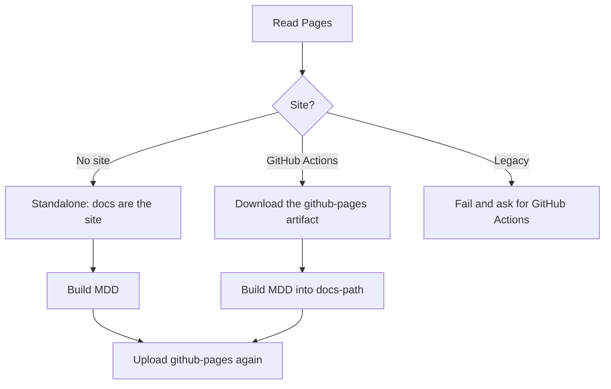

# Docs Build Flow Action

[](https://opensource.org/licenses/MIT) [](https://github.com/wgtechlabs/docs-build-flow-action/releases) [](https://github.com/wgtechlabs)

Build [MDD](https://github.com/wgtechlabs/mdd) documentation with the `wgtechlabs/mdd` image and publish it to GitHub Pages.

The action reads the repository Pages site, builds the docs, and uploads a `github-pages` artifact. `actions/deploy-pages` publishes that artifact.

---

## Why use this action?

Pages can host a whole site, or a site that already has its own files. The docs still need a public base path, and a second upload must replace the `github-pages` artifact from the same run.

This action does that for an MDD folder. You keep the Markdown in the repository. The action builds the HTML.

---

## How it works



The action calls `GET /repos/{owner}/{repo}/pages`.

- **No Pages site.** Standalone mode. The docs are the whole site. The public base path is `/<repo>/` for a project site, or `/` for a custom domain or a `<owner>.github.io` repository.
- **GitHub Actions source.** Workflow mode. Put this action between `actions/upload-pages-artifact` and `actions/deploy-pages`. It downloads the `github-pages` artifact from the same run, builds the docs into `<docs-path>/` (default `docs`), and uploads the merged artifact again. The upload uses `overwrite`, so the duplicate artifact name is replaced. The rest of the site stays at `/`.
- **Legacy source.** The action fails and tells you to switch the Pages source to GitHub Actions.

`base-path` is the public prefix MDD writes into links. When you leave it empty, workflow mode uses `/<repo>/<docs-path>/`, or `/<docs-path>/` when the site is served at the domain root. Set `base-path` when you want a different prefix.

MDD does not ship a static-export command. The `wgtechlabs/mdd` image compiles the folder with its `build()` API and then serves the files. This action runs that `build()` export and keeps the files. The default image tag is `0.3.0`.

---

## Features

- Detects a missing Pages site, a GitHub Actions site, and a legacy site
- Builds the pinned `wgtechlabs/mdd` image into static HTML
- Merges docs into an existing Pages artifact without moving the site root
- Replaces the same-run `github-pages` artifact
- Lets you override the public base path

---

## Quick start

Use `@v1` after the first release. The release workflow moves that major tag.

### Standalone docs site

```yaml
permissions:
  contents: read
  pages: read
  actions: write
  id-token: write

steps:
  - uses: actions/checkout@v7.0.1
  - uses: wgtechlabs/docs-build-flow-action@v1
    with:
      source-dir: mdd
  - uses: actions/deploy-pages@v5.0.1
```

### Docs inside an existing site

```yaml
steps:
  - uses: actions/checkout@v7.0.1
  - uses: actions/upload-pages-artifact@v5.0.0
    with:
      path: ./site
  - uses: wgtechlabs/docs-build-flow-action@v1
    with:
      source-dir: mdd
      docs-path: docs
  - uses: actions/deploy-pages@v5.0.1
```

The runner needs Docker. The MDD folder must contain `contents/index.md`. Full workflows are in [`examples/`](examples/).

---

## Inputs

| Input | Description | Required | Default |
|-------|-------------|----------|---------|
| `github-token` | Token used to read Pages and the current run artifact | No | `${{ github.token }}` |
| `base-path` | Public docs prefix. Empty selects the prefix from the Pages site. | No | `""` |
| `docs-path` | Directory inside an existing site that receives the docs | No | `docs` |
| `source-dir` | MDD folder in the repository | No | `mdd` |
| `mdd-version` | Pinned `wgtechlabs/mdd` image tag | No | `0.3.0` |

In workflow mode, an override should end with `/<docs-path>/`. The action warns when it does not.

---

## Outputs

| Output | Description |
|--------|-------------|
| `mode` | `standalone` or `workflow` |
| `base-path` | Public base path passed to MDD |
| `docs-path` | Directory that received the docs. Empty in standalone mode. |
| `artifact-name` | `github-pages` |

---

## Permissions

```yaml
permissions:
  contents: read
  pages: read
  actions: write
  id-token: write
```

`id-token: write` is for `actions/deploy-pages`. Checkout the repository before this action so the MDD folder is in the workspace.

---

## Examples

- [`examples/standalone.yml`](examples/standalone.yml) publishes the docs as the whole site
- [`examples/workflow.yml`](examples/workflow.yml) adds the docs under `/docs/` on an existing site

---

## Troubleshooting

### Legacy Pages source

The log says the Pages site uses the legacy build. Open the repository Pages settings and set the source to GitHub Actions. Run this action after `actions/upload-pages-artifact`.

### No github-pages artifact

Workflow mode found a Pages site, but this run has not uploaded `github-pages`. Add `actions/upload-pages-artifact` in the same job, before this action. A custom artifact name is not supported.

### Docker is missing

Use a Linux runner with Docker. The action pulls `wgtechlabs/mdd:<mdd-version>`.

### The MDD folder is rejected

`source-dir` must be a real MDD folder. It needs `contents/index.md`, or the index named by `config.json`. The default folder is `mdd`.

### Doc links 404

The HTML prefix does not match the public URL. Set `base-path` to the prefix readers use, including the trailing slash. For a project site in workflow mode that is `/<repo>/<docs-path>/`.

### Pages upload fails

The job needs `actions: write`. The action uploads `github-pages` again with `overwrite: true` and keeps the archive for 1 day, matching `actions/upload-pages-artifact`.

---

## Contributing

See [CONTRIBUTING.md](CONTRIBUTING.md). Pull requests go to `dev`.

Do not add `CHANGELOG.md`. The release workflow generates it.

---

## License

MIT. See [LICENSE](LICENSE).

---

## Support

- Star the repository
- Open an issue
- Sponsor the work from [FUNDING.yml](.github/funding.yml)

---

## Related actions

- [release-build-flow-action](https://github.com/wgtechlabs/release-build-flow-action)
- [container-build-flow-action](https://github.com/wgtechlabs/container-build-flow-action)
- [package-build-flow-action](https://github.com/wgtechlabs/package-build-flow-action)

---

<div align="center">

**Built with ❤️ by WG Technology Labs**

[](https://github.com/wgtechlabs)

</div>
