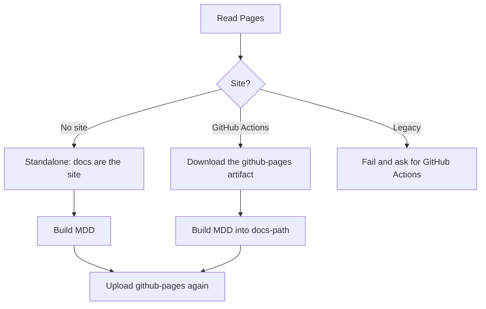

# Docs Build Flow Action


<!-- Created with GitHub Repo Banner by Waren Gonzaga: https://ghrb.waren.build -->

[](https://opensource.org/licenses/MIT) [](https://github.com/wgtechlabs/docs-build-flow-action/releases) [](https://github.com/wgtechlabs)

This action builds [MDD](https://github.com/wgtechlabs/mdd) docs and publishes them to GitHub Pages.
Use it when the docs are the whole site.
Use it when the docs sit inside a site that already exists.

**Contents**

- [Features](#-features)
- [Getting Started](#-getting-started)
- [Usage](#-usage)
- [Configuration](#️-configuration)
- [Development](#️-development)
- [Contributing](#-contributing)
- [Issues & Support](#-issues--support)
- [Support the Project](#-support-the-project)
- [Code of Conduct](#-code-of-conduct)
- [License](#-license)
- [Authors & Contributors](#-authors--contributors)

## ✨ Features

- Detects a missing Pages site, a GitHub Actions site, and a legacy site.
- Builds the pinned `wgtechlabs/mdd` image into static HTML.
- Merges the docs into an existing Pages artifact and keeps the site root.
- Replaces the `github-pages` artifact from the same run.
- Accepts a custom public base path.

## 🚀 Getting Started

Use `wgtechlabs/docs-build-flow-action@v0`.
The `v0` tag tracks the latest v0 release.
The current release is [v0.1.0](https://github.com/wgtechlabs/docs-build-flow-action/releases/tag/v0.1.0).

### Prerequisites

- Use a Linux runner with Docker, such as `ubuntu-latest`.
- Keep an [MDD](https://github.com/wgtechlabs/mdd) folder in the repository. The default path is `mdd`.
- An MDD folder has `contents/index.md`.
- If `config.json` sets `paths.contents`, MDD looks for `index.md` in that folder.
- Checkout the repository before this action.

### Permissions

```yaml
permissions:
  contents: read
  pages: read
  actions: write
  id-token: write
```

The checkout step needs `contents: read`.
`pages: read` lets this action read the Pages site.
`actions: write` lets this action upload the `github-pages` artifact.
`id-token: write` is for `actions/deploy-pages`.

### Publish the docs as the whole site

Use this path when the repository has no Pages site.
This workflow follows [`examples/standalone.yml`](examples/standalone.yml) and pins `@v0`.

```yaml
name: Publish docs

on:
  push:
    branches: [main]

permissions:
  contents: read
  pages: read
  actions: write
  id-token: write

concurrency:
  group: pages
  cancel-in-progress: false

jobs:
  deploy:
    runs-on: ubuntu-latest
    environment:
      name: github-pages
      url: ${{ steps.deploy.outputs.page_url }}
    steps:
      - name: Checkout code
        uses: actions/checkout@v7.0.1

      - name: Build docs
        uses: wgtechlabs/docs-build-flow-action@v0
        with:
          source-dir: mdd

      - name: Deploy Pages
        id: deploy
        uses: actions/deploy-pages@v5.0.1
```

The action uploads a `github-pages` artifact.
`actions/deploy-pages` publishes the docs as the whole site.
A project site uses `/<repo>/`.
A custom domain or an `<owner>.github.io` repository uses `/`.

## 📖 Usage

### Add the docs to an existing site

Put this action between `actions/upload-pages-artifact` and `actions/deploy-pages`.
Run both steps in the same job.
This workflow follows [`examples/workflow.yml`](examples/workflow.yml) and pins `@v0`.

```yaml
name: Publish site and docs

on:
  push:
    branches: [main]

permissions:
  contents: read
  pages: read
  actions: write
  id-token: write

concurrency:
  group: pages
  cancel-in-progress: false

jobs:
  deploy:
    runs-on: ubuntu-latest
    environment:
      name: github-pages
      url: ${{ steps.deploy.outputs.page_url }}
    steps:
      - name: Checkout code
        uses: actions/checkout@v7.0.1

      - name: Upload site
        uses: actions/upload-pages-artifact@v5.0.0
        with:
          path: ./site

      - name: Build docs into the site
        uses: wgtechlabs/docs-build-flow-action@v0
        with:
          source-dir: mdd
          docs-path: docs

      - name: Deploy Pages
        id: deploy
        uses: actions/deploy-pages@v5.0.1
```

The docs are published under `docs-path`.
The default directory is `docs`.
The rest of the site stays at `/`.

### How it works



The action calls `GET /repos/{owner}/{repo}/pages`.

- **No Pages site.** Standalone mode. The docs are the whole site. `docs-path` is empty.
- **GitHub Actions source.** Workflow mode. The action downloads the `github-pages` artifact from this run, builds the docs into `<docs-path>/`, and uploads that artifact again. The upload sets `overwrite: true`, so the new archive replaces the previous one. It keeps the archive for 1 day.
- **Legacy source.** The action fails. Set the Pages source to GitHub Actions. Then run this action after `actions/upload-pages-artifact` and before `actions/deploy-pages`.

MDD has no static-export command.
The `wgtechlabs/mdd` image runs `build()`, then starts a server.
This action calls `build()` and keeps the files.
The default image tag is `0.3.0`.

### Examples

- [`examples/standalone.yml`](examples/standalone.yml) publishes the docs as the whole site.
- [`examples/workflow.yml`](examples/workflow.yml) adds the docs under `/docs/` on an existing site.

### Related actions

- [release-build-flow-action](https://github.com/wgtechlabs/release-build-flow-action)
- [container-build-flow-action](https://github.com/wgtechlabs/container-build-flow-action)
- [package-build-flow-action](https://github.com/wgtechlabs/package-build-flow-action)

## ⚙️ Configuration

### Inputs

| Input | Description | Required | Default |
| --- | --- | --- | --- |
| `github-token` | Token used to read Pages settings and the current run artifact | No | `${{ github.token }}` |
| `base-path` | Public docs prefix. Empty uses `/<repo>/<docs-path>/`, or `/<docs-path>/` on a custom domain or a `*.github.io` site. Standalone mode uses the site root. | No | `""` |
| `docs-path` | Directory inside an existing Pages site that receives the docs | No | `docs` |
| `source-dir` | MDD folder in the repository | No | `mdd` |
| `mdd-version` | Pinned `wgtechlabs/mdd` image tag | No | `0.3.0` |

Leave `base-path` empty to let the action choose the prefix.
A project site starts at `/<repo>/`.
A custom domain or an `<owner>.github.io` repository starts at `/`.
Workflow mode adds `<docs-path>/` to that prefix.
Standalone mode does not add `<docs-path>`.
Set `base-path` when you need a different prefix.
The action adds a leading slash and a trailing slash when they are missing.
In workflow mode, the prefix should end with `/<docs-path>/`.
The action warns when it does not.

`source-dir` and `docs-path` must be relative paths, such as `mdd` or `docs`.
They cannot contain a hidden segment.

### Outputs

| Output | Description |
| --- | --- |
| `mode` | `standalone` when the repository has no Pages site, otherwise `workflow` |
| `base-path` | Public base path passed to MDD |
| `docs-path` | Directory inside the site that received the docs. Empty in standalone mode. |
| `artifact-name` | Pages artifact name. The value is `github-pages`. |

## 🛠️ Development

Run the tests from the repository root:

```sh
bash run-tests.sh
```

The [test workflow](.github/workflows/test.yml) runs this command on pull requests and on pushes to `dev` and `main`.

This action runs four scripts in order:

1. `scripts/resolve-pages.sh` reads the Pages site and sets the mode and base path.
2. `scripts/prepare-site.sh` creates the site directory. In workflow mode it downloads the current `github-pages` artifact.
3. `scripts/build-docs.sh` runs `scripts/mdd-build.mjs` in the pinned `wgtechlabs/mdd` image.
4. `scripts/package-site.sh` packs the site as `artifact.tar`.

See [CONTRIBUTING.md](CONTRIBUTING.md) for the branch and commit rules.

## 🤝 Contributing

Contributions are welcome.
See [CONTRIBUTING.md](CONTRIBUTING.md).
Open pull requests against `dev`.

Do not add or edit `CHANGELOG.md`.
The release workflow generates it.

## 🐛 Issues & Support

Open a [GitHub issue](https://github.com/wgtechlabs/docs-build-flow-action/issues) for bugs and questions.

Report a security vulnerability in private.
See [SECURITY.md](SECURITY.md).
You can also email [security@wgtechlabs.com](mailto:security@wgtechlabs.com).
Do not open a public issue for a vulnerability.

### Legacy Pages source

The log says the Pages site uses the legacy build.
Open the repository Pages settings and set the source to GitHub Actions.
Run this action after `actions/upload-pages-artifact` and before `actions/deploy-pages`.

### No github-pages artifact

Workflow mode found a Pages site, but this run has not uploaded `github-pages`.
Add `actions/upload-pages-artifact` in the same job, before this action.
A custom artifact name is not supported.

### Artifact download is denied

The log asks for `actions: read` when the download returns HTTP 401 or 403.
Use `actions: write` on this job so the action can also upload `github-pages`.

### Docker is missing

Use a Linux runner with Docker.
The action pulls `wgtechlabs/mdd:<mdd-version>`.

### The MDD folder is rejected

`source-dir` must be a directory in the checkout.
An MDD folder has `contents/index.md`.
If `config.json` sets `paths.contents`, MDD looks for `index.md` in that folder.
The default folder is `mdd`.
Checkout the repository before this action.

### Doc links 404

The HTML prefix does not match the public URL.
Set `base-path` to the prefix readers use.
For a project site in workflow mode, that prefix is `/<repo>/<docs-path>/`.

### Pages upload fails

The job needs `actions: write`.
The action uploads `github-pages` again with `overwrite: true`.
It keeps the archive for 1 day.

## 💖 Support the Project

- Star this repository.
- Sponsor [WG Technology Labs](https://github.com/sponsors/wgtechlabs) or [Waren Gonzaga](https://github.com/sponsors/warengonzaga).
- Buy a coffee at [Buy Me a Coffee](https://buymeacoffee.com/wgtechlabs).

These destinations are listed in [FUNDING.yml](.github/funding.yml).

## 📋 Code of Conduct

This project follows the [Contributor Covenant Code of Conduct](CODE_OF_CONDUCT.md).

## 📄 License

MIT. See [LICENSE](LICENSE).

## 👥 Authors & Contributors

Maintained by [Waren Gonzaga](https://github.com/warengonzaga) under [WG Technology Labs](https://github.com/wgtechlabs).

<div align="center">

**Built with ❤️ by WG Technology Labs**

</div>
